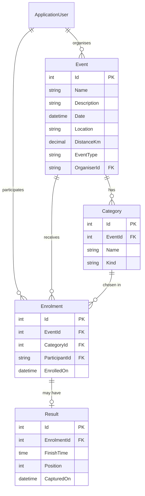

# RaceDay

- [https://youtu.be/e5Qc235w6vw](https://youtu.be/e5Qc235w6vw)


RaceDay is a web application for running, walking and Srinting events. Organisers create events and split them into categories, participants enrol in the event and category they want, and organisers capture finish times and positions once the race is over. The same system is also exposed as a REST API with Swagger documentation and JWT login.

Built with ASP.NET Core MVC, ASP.NET Core Identity, Entity Framework Core and SQL Server.

---

## Contents

1. [What the system does](#what-the-system-does)
2. [User roles](#user-roles)
3. [How it is built (ASP.NET MVC)](#how-it-is-built-aspnet-mvc)
4. [Data model](#data-model)
5. [REST API and Swagger](#rest-api-and-swagger)
6. [Getting started](#getting-started)
7. [Testing and CI](#testing-and-ci)
8. [Project structure](#project-structure)

---

## What the system does

| Area | What happens |
|---|---|
| **Accounts** | Anyone can register. New accounts are automatically given the **Participant** role. Login uses ASP.NET Core Identity. |
| **Events** | An organiser creates an event with a name, description, date, location, distance (0.1 to 1000 km) and type (Run, Walk or Sprinting). |
| **Categories** | Each event has its own categories, such as "Under 20", "Senior", "10km" or "21km". A category is either an **Age** or a **Distance** category. |
| **Enrolment** | A participant picks an event and one of its categories. The system stops enrolment when the event has already happened, when the event has no categories, or when the participant is already enrolled. A participant can withdraw before the event, as long as no result exists yet. |
| **Results** | After the event, the organiser captures each participant's finish time and finishing position. |
| **Dashboard** | Organisers see their events with category, enrolment and result counts, plus recent enrolments. |
| **User management** | Admins and organisers can open the user list and change which roles a user has. |
| **API** | Registration, login, events, categories and enrolments are available as JSON endpoints, documented and testable in Swagger. |

---

## User roles

There are three roles: **Admin**, **Organiser** and **Participant**. Roles are created and an initial Admin account is seeded automatically when the application starts (see `Program.cs`). Change the seeded password before deploying anywhere real.

### Admin
The administrator looks after the system itself.
- Manages users and roles through the **Manage Users** page (assign or remove Admin, Organiser and Participant).
- Can create events and categories, and capture results, just like an organiser.
- Can view every event and enrolment.
- In the API, an Admin can update or delete any event, not only their own.

### Organiser
The organiser runs events.
- Creates, edits and deletes **their own** events. An event that already has enrolments cannot be deleted.
- Adds, edits and removes categories for their events.
- Views the list of enrolments for their events.
- Captures results (finish time and position) once an event has taken place.
- Uses the dashboard to see enrolment and result counts for their events.
- Cannot edit or delete another organiser's events.

### Participant
The participant takes part in events.
- Registers an account (automatically a Participant).
- Browses events and their categories.
- Enrols in an event by choosing a category, and sees their enrolments on **My Enrolments**.
- Withdraws from an event before it takes place, provided no result has been captured.
- Cannot create or manage events, categories or results, and cannot see other people's enrolments.

### Access summary

| Action | Admin | Organiser | Participant |
|---|:---:|:---:|:---:|
| View events and categories | Yes | Yes | Yes |
| Create events and categories | Yes | Yes | No |
| Edit or delete events | Own events (API: any) | Own events | No |
| Enrol in an event | No (API) | No (API) | Yes |
| View an event's enrolments | Yes | Own events | No |
| Capture results | Yes | Own events | No |
| Manage users and roles | Yes | See note below | No |

> **Note:** in the MVC site, the Manage Users page is currently available to both Admin and Organiser accounts. Restrict it to Admin only if you want strictly admin-controlled role management.

Role rules are enforced on the server with `[Authorize(Roles = "...")]` on controllers and actions. Hiding a link in the navigation bar is only a convenience and is never the security check.

---

## How it is built (ASP.NET MVC)

The web application follows the **Model-View-Controller** pattern. Each part has one job:

```
Browser  -->  Controller  -->  Model / Database
                 |
                 v
               View  -->  HTML back to the browser
```

### Models
Plain C# classes in `Models/` that describe the data and its validation rules, for example `Event`, `Category`, `Enrolment` and `Result`. Data annotations such as `[Required]`, `[StringLength]` and `[Range]` define the rules once, and both the forms and the API reuse them. View models in `Models/ViewModels/` shape data for a particular screen (for example `EnrolViewModel` and `CaptureResultsViewModel`) so views never receive more than they need.

### Views
Razor `.cshtml` files in `Views/`, one folder per controller (`Events`, `Categories`, `Enrolments`, `Dashboard`). `Views/Shared/_Layout.cshtml` is the page template with the navigation bar. It shows different links depending on the user's role. `_LoginPartial.cshtml` renders Register and Login, or the user's name and Logout.

### Controllers
Classes in `Controllers/` that receive a request, check permissions, use the database, and choose a view or redirect.

| Controller | Responsibility |
|---|---|
| `HomeController` | Landing and privacy pages |
| `EventsController` | List, view, create, edit and delete events (ownership enforced) |
| `CategoriesController` | Manage the categories of an event |
| `EnrolmentsController` | Enrol, view "my enrolments", withdraw, and list an event's enrolments |
| `ResultsController` | Capture results for an event |
| `DashboardController` | Role-based dashboard data |
| `UserRoles` | List users and assign roles |
| `Controllers/Api/*` | The REST API (see below) |

### Supporting pieces
- **ASP.NET Core Identity** handles accounts, password hashing, login and roles. `ApplicationUser` extends `IdentityUser` with first name, last name, gender and a profile image path. The Identity pages (login, register, manage account) live in `Areas/Identity`.
- **Entity Framework Core** maps the models to SQL Server through `ApplicationDbContext`. Schema changes are made with migrations in `Migrations/`.
- **Dependency injection** supplies the database context, `UserManager`, `JwtTokenService` and `IProfileImageService` to the classes that need them.
- **Security basics:** anti-forgery tokens on every POST form, whitelisted bindable properties on edit actions to prevent over-posting, and server-side ownership checks so an organiser can only change their own events.
- **Startup (`Program.cs`)** registers services, applies migrations, seeds the roles and the initial Admin, and configures the request pipeline.

---

## Data model



- An **organiser** owns many events.
- An **event** has many categories and many enrolments.
- An **enrolment** links one participant, one event and one of that event's categories.
- An enrolment has at most one **result** (finish time and position).

---

## REST API and Swagger

The API lives in `Controllers/Api` and uses **JWT bearer tokens** instead of the website's login cookie.

### Try it in the browser
1. Run the app in Development and open `/swagger`.
2. Call `POST /api/auth/register`, then `POST /api/auth/login`.
3. Copy the `token` from the login response.
4. Click **Authorize**, paste the token, and confirm.
5. All endpoints can now be tried directly from Swagger. Every endpoint shows its purpose, the data it expects and the responses it can return.

### Endpoints

| Method | Route | Who can call it | Purpose |
|---|---|---|---|
| POST | `/api/auth/register` | Anyone | Create a Participant or Organiser account |
| POST | `/api/auth/login` | Anyone | Log in and receive a JWT |
| GET | `/api/events` | Any logged-in user | List events (filter by `type` and `upcomingOnly`) |
| GET | `/api/events/{id}` | Any logged-in user | Get one event |
| POST | `/api/events` | Admin, Organiser | Create an event |
| PUT | `/api/events/{id}` | Event owner or Admin | Update an event |
| DELETE | `/api/events/{id}` | Event owner or Admin | Delete an event with no enrolments |
| GET | `/api/events/{eventId}/categories` | Any logged-in user | List an event's categories |
| POST | `/api/events/{eventId}/categories` | Event owner or Admin | Add a category |
| POST | `/api/events/{eventId}/enrolments` | Participant | Enrol in an event |
| GET | `/api/events/{eventId}/enrolments` | Event owner or Admin | List an event's enrolments |
| GET | `/api/enrolments/my` | Participant | List my enrolments |
| DELETE | `/api/enrolments/{id}` | Participant (own) | Withdraw from an event |

### Status codes used

| Code | Meaning in this API |
|---|---|
| 200 / 201 / 204 | Success, created, success with no content |
| 400 | Invalid data or a broken business rule (for example a past event) |
| 401 | Not logged in, or the token is missing, invalid or expired |
| 403 | Logged in, but the role or ownership does not allow it |
| 404 | The record does not exist |
| 409 | Conflict, such as enrolling twice or deleting an event that has enrolments |

---

## Getting started

### Requirements
- .NET 10 SDK
- SQL Server or SQL Server LocalDB
- Visual Studio 2022 or later (optional)

### Run locally
1. Clone the repository.
2. Check the `DefaultConnection` string in `appsettings.json` points at your SQL Server instance.
3. Check the `Jwt` section in `appsettings.json` has a key of at least 32 characters. Use your own secret for anything beyond coursework.
4. Start the app:

   ```bash
   dotnet run
   ```

   Migrations are applied automatically on startup, and the roles and the initial Admin account are seeded.
5. Open the site at the URL shown in the console, or `/swagger` for the API.

### Database migrations
To create a new migration after changing a model, run this in Package Manager Console:

```powershell
Add-Migration MigrationName
Update-Database
```

---

## Testing and CI

The `RaceDay.Tests` project contains xUnit tests that start the real application in memory with an in-memory database. Tests send real HTTP requests with real JWTs, so authentication and role rules are tested exactly as they run in production.

**What is covered**

| Area | Success cases | Failure cases |
|---|---|---|
| Registration and login | Valid registration, organiser registration, login returns a working token | Duplicate email, weak password, invalid email, self-assigning Admin, wrong password, unknown user |
| Event management by organisers | Create, update, delete own event, add categories | Invalid distance, past date, other organiser's event (403), event with enrolments (409), unknown event (404) |
| Role-based access | Every logged-in role can list events | No token (401), invalid token (401), Participant blocked from create, update, delete and category endpoints (403) |
| Event enrolment | Participant enrols and the enrolment is stored with the right participant, event and category; withdrawal works | Duplicate enrolment, past event, category from another event, unknown event, Organiser or Admin blocked (403), no token (401) |

**Run the tests**

```bash
dotnet test
```

**Continuous integration:** the GitHub Actions workflow in `.github/workflows/ci.yml` restores, builds and runs all tests on every push.


---

## Project structure

```
RaceDay.slnx
RaceDay.csproj
Program.cs                  Startup, services, seeding, pipeline
appsettings.json
Areas/Identity/             Login, register and account pages
Controllers/                MVC controllers
Controllers/Api/            REST API controllers and DTOs
Data/                       ApplicationDbContext and ApplicationUser
Migrations/                 EF Core migrations
Models/                     Entities (Event, Category, Enrolment, Result)
Models/ViewModels/          Screen-specific view models
Services/                   JWT token service
Views/                      Razor views and shared layout
wwwroot/                    Static files (CSS, JavaScript, images)
RaceDay.Tests/              xUnit tests
.github/workflows/ci.yml    GitHub Actions workflow
```
